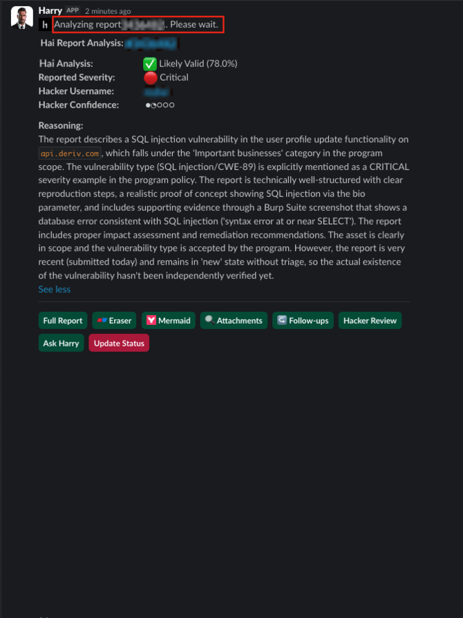

# H1 Analyst Agent - HackerOne AI Assistant

H1 Analyst Agent is a Slack bot that helps analyze HackerOne reports using AI. It can fetch report details, analyze the validity of security reports, and provide insights about hackers based on their profiles.



## Features

### **Core Analysis Capabilities**
- Analyze HackerOne reports for validity with AI-powered insights
- Extract reporter usernames and profile information
- Calculate credibility scores for hackers based on reputation, impact, and signal
- Provide AI-powered analysis of hacker profiles with confidence scoring
- Suggest follow-up actions for reports
- **Clickable report links** - Report numbers automatically link to HackerOne for easy access
- **Parallel processing** - Hai analyses run in parallel for improved performance

### **Slash Commands**
- **`/report`** - Generate comprehensive weekly HackerOne report summaries

### **Security & Protection**
- **Comprehensive authorization system** - Restricts bot access to authorized security team members only
- **Security audit logging** - Logs all unauthorized access attempts
- **Complete interaction protection** - All mentions, buttons, and modals are protected
- **Input validation** - Advanced protection against prompt injection and malicious payloads
- **Secret protection** - Multi-layered system prevents credential leakage in logs or responses
- **File validation** - Magic number verification for secure file handling
- **Slack request verification** - HMAC signature validation for all Slack requests
- **Dependency pinning** - Exact version pinning for all dependencies

## Setup

### Prerequisites

- Python 3.8+
- HackerOne API credentials
- Slack bot token and app token

### Installation

1. Clone the repository
2. Install dependencies:
   ```bash
   pip install -r requirements.txt
   ```
3. Copy the `.env.example` file to `.env` and fill in your credentials:
   ```bash
   cp .env.example .env
   ```

### Configuration

The H1 Analyst Agent is **organization-agnostic** and uses a comprehensive configuration system with secure defaults.

1. **Copy the example configuration:**
   ```bash
   cp .env.example .env
   ```

2. **Edit `.env` and configure the required parameters:**

   **API Credentials:**
   - `TOKEN_NAME` and `TOKEN_VALUE` - Your HackerOne API credentials
   - `SLACK_BOT_TOKEN` and `SLACK_APP_TOKEN` - Your Slack bot tokens
   - `ERASER_API_KEY` - Your Eraser.io API key for diagram generation

   **Security & Access:**
   - `AUTHORIZED_USERS` - Comma-separated list of authorized Slack user IDs
   - `ALLOWED_CHANNELS` - Comma-separated list of allowed channel names

   **Organization Settings:**
   - `ORGANIZATION_NAME` - Your organization's name
   - `ORGANIZATION_SECURITY_TEAM_NAME` - Your security team's name
   - `ORGANIZATION_DOMAINS` - Your domains (prevents auto-linking in Slack)
   - `ORGANIZATION_PROGRAMS` - Your HackerOne program handles (format: `handle:PUBLIC`)
   - `ORGANIZATION_PROGRAM_PATTERNS` - Regex patterns for program matching

3. **Example organization configuration:**
   ```bash
   ORGANIZATION_NAME=AcmeCorp
   ORGANIZATION_SECURITY_TEAM_NAME=AcmeCorp Security Team
   ORGANIZATION_DOMAINS=acmecorp.com,acmecorp.io
   ORGANIZATION_PROGRAMS=acmecorp:PUBLIC,acmecorp_private:PRIVATE
   ORGANIZATION_PROGRAM_PATTERNS=AcmeCorp\\.com,AcmeCorp Private
   ```

4. **Test your configuration:**
   ```bash
   python -c "from src.config import validate_config; validate_config(); print('✅ Configuration valid')"
   ```

**Note:** The system comes pre-configured for Deriv but can be easily adapted for any organization. See `.env.example` for all available options including API timeouts, logging levels, and performance tuning.

## Slack App Configuration

### Quick Setup Checklist

1. **Create Slack App** at https://api.slack.com/apps

2. **Add Bot Token Scopes** (OAuth & Permissions):
   - `chat:write`, `app_mentions:read`, `files:write`, `users:read`
   - `channels:read`, `groups:history`, `commands`

3. **Configure Events** (Event Subscriptions):
   - Subscribe to `app_mention` events

4. **Enable Socket Mode**:
   - Create App-Level Token with `connections:write` scope

5. **Install App** to your workspace

6. **Invite bot** to approved channels:
   ```
   /invite @h1_analyst_agent
   ```

### Security Features

- **Dual-layer channel security**: Bot only works in manually invited channels AND channels listed in `ALLOWED_CHANNELS`
- **Authorization system**: Only specified user IDs can interact with the bot
- **Request verification**: All Slack requests are HMAC signature validated

## Security & Authorization

H1 Analyst Agent includes a comprehensive authorization system that restricts access to authorized security team members only.

### Authorization Features

- **Whitelist-only access** - Only specified Slack user IDs can interact with the bot
- **Complete protection** - All interactions (mentions, buttons, modals) are protected
- **Security audit logging** - All unauthorized access attempts are logged
- **Fail-secure design** - Denies access by default if authorization check fails
- **User-friendly warnings** - Unauthorized users receive clear warning messages

### Setting Up Authorization

1. **Get Slack User IDs** for your security team members:
   - Right-click on a user's name in Slack → "Copy member ID"
   - Or right-click → "Copy link" and extract ID from URL

2. **Add user IDs to `.env`**:
   ```
   AUTHORIZED_USERS=U123456789,U987654321,U555666777
   ```

3. **Unauthorized users will see**:
   ```
   WARNING: Unauthorized access is prohibited. This agent is intended solely for the Security Team.
   ```

### Security Audit Logs

All unauthorized access attempts are logged with:
- User ID and username
- Attempted action
- Timestamp
- Context information

Example log entry:
```
UNAUTHORIZED ACCESS ATTEMPT - User: john.doe (U1234567890) | Action: handle_mention | Context:
```

## Running the Bot

Start the Slack bot:

```bash
python run.py
```

## Usage

### **Report Analysis**

Mention the bot followed by a HackerOne report ID:

```
@h1_analyst_agent 123456
@h1_analyst_agent #123456
```

**Note:** The bot handles various formats including Slack's auto-formatted telephone links.

The bot will analyze the report and provide:
- **Validity assessment** with confidence percentage
- **Clickable report link** to HackerOne for easy access
- **Detailed reasoning** covering scope, duplicates, and technical validity
- **Reporter information** with credibility score visualization
- **Interactive follow-up options** for deeper analysis

### **Slash Commands**

#### **Weekly Reports**
Generate comprehensive weekly summaries:
```
/report
```
Or via mention:
```
@h1_analyst_agent /report
```

### **Interactive Features**

After analysis, use the interactive buttons for deeper investigation:

**Analysis & Investigation:**
- 🔍 **Full Report Analysis** - Comprehensive Hai analysis with detailed insights
- 📎 **Attachment Analysis** - Analyze report attachments and files
- 👤 **Hacker Profile** - Detailed hacker assessment and credibility scoring
- ✅ **Validate Report** - Validate report details and technical accuracy

**Visual Diagrams:**
- 📊 **Eraser** - Generate visual diagrams and flowcharts
- 📊 **Mermaid Diagrams** - Create flowcharts and sequence diagrams

**Actions & Follow-up:**
- ❓ **Ask Questions** - Ask custom questions about the report
- 🎯 **Suggest Follow-up** - Get AI-powered follow-up action suggestions
- 📝 **Update Status** - Change report status (triaged, etc.)


## Troubleshooting

### Common Issues

**Bot not responding:**
- Verify Slack tokens are correct in `.env`
- Ensure bot is invited to the channel: `/invite @h1_analyst_agent`
- Check logs for errors

**Authorization problems:**
- Get your Slack User ID: Right-click your name → "Copy member ID"
- Add your ID to `AUTHORIZED_USERS` in `.env` (comma-separated, no spaces)
- Restart bot after updating authorization
- Check logs for "Authorization initialized with X authorized users"

**Configuration issues:**
- Ensure `.env` file exists and has correct permissions
- Test configuration: `python -c "from src.config import validate_config; validate_config()"`
- Verify no syntax errors in `.env`

**Report analysis problems:**
- Bot supports 6-8 digit report IDs (100000-99999999)
- Try different formats: `123456`, `#123456`, or copy-paste from Slack
- Large reports may take 30-90 seconds to analyze

**Slash commands not working:**
- Verify bot has required scopes: `chat:write`, `app_mentions:read`, `commands`
- Check channel permissions and user authorization

## Running Tests

The project uses pytest for testing. To run all tests:

```bash
# Install test dependencies first
pip install -r requirements.txt

# Run tests with coverage report
pytest

# Run specific test file
pytest tests/test_config.py

# Run tests with verbose output
pytest -v
```

The test suite includes:
- Configuration validation tests
- Utility function tests
- Handler tests with mocked dependencies

Coverage reports are generated in HTML format in the `htmlcov` directory.

## License

[MIT License](LICENSE)
